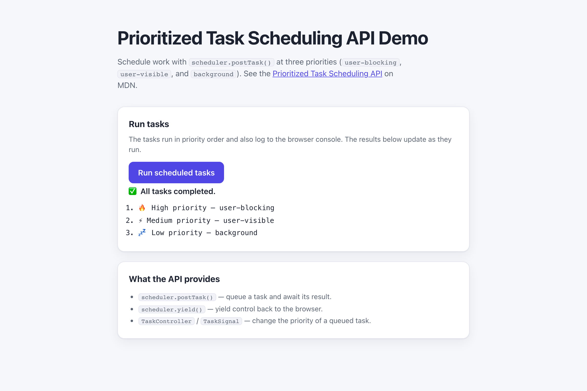

# WebSharper.TaskScheduling

[](https://github.com/dotnet-websharper/TaskSchedulingAPI)

WebSharper bindings for the [Prioritized Task Scheduling API](https://developer.mozilla.org/en-US/docs/Web/API/Scheduler) —
scheduling tasks at `user-blocking`, `user-visible`, and `background` priorities from F# and C# web apps.

The API is exposed through `window.scheduler` (and `navigator.scheduling` for input-pending checks). Check the
browser compatibility table on MDN before relying on it in production.

This repository contains:

| Project | Purpose |
| --- | --- |
| `WebSharper.TaskScheduling` | The binding: WIG definitions for `Scheduler`, `TaskController`, `TaskSignal`, `TaskPriority`, `TaskPriorityChangeEvent`, `Scheduling`, and their option dictionaries. |
| `WebSharper.TaskScheduling.Extensions` | `[<Inline>]` client extensions: `window.scheduler`, `workerGlobalScope.scheduler`, and `navigator.scheduling`. |
| `WebSharper.TaskScheduling.Sample` | An ASP.NET Core SPA that schedules tasks at three priorities and shows the results in the page. |

## Live demos

**Try it live:** [Open the sample in your browser](https://dotnet-websharper.github.io/TaskSchedulingAPI/)



The sample doubles as the binding's test case: it runs tasks at three priorities and logs their order to the page and the console.

- **Sample (this repository):** <https://dotnet-websharper.github.io/TaskSchedulingAPI/>
- **Source repository:** <https://github.com/dotnet-websharper/TaskSchedulingAPI>
- **WebSharper bindings:** <https://websharper.com/bindings>

## Features

- `Scheduler` (`postTask`, `yield`) with `TaskOptions` (`priority`, `signal`, `delay`).
- `TaskPriority` (`user-blocking`, `user-visible`, `background`).
- `TaskController` (`setPriority`) and `TaskSignal` (`priority`, `onPriorityChange`).
- `TaskPriorityChangeEvent` and its `TaskPriorityChangeEventInit`.
- `Scheduling` (`isInputPending`) and `SchedulingInputPendingOptions`.
- `window.scheduler`, `workerGlobalScope.scheduler`, and `navigator.scheduling` in the Extensions assembly.

## Installation

The binding is not currently published to NuGet. Reference the projects from source:

```bash
git clone https://github.com/dotnet-websharper/TaskSchedulingAPI.git
```

```xml
<ItemGroup>
  <ProjectReference Include="path/to/WebSharper.TaskScheduling/WebSharper.TaskScheduling.fsproj" />
  <ProjectReference Include="path/to/WebSharper.TaskScheduling.Extensions/WebSharper.TaskScheduling.Extensions.fsproj" />
</ItemGroup>
```

## Usage

```fsharp
namespace WebSharper.TaskScheduling.Demo

open WebSharper
open WebSharper.JavaScript
open WebSharper.TaskScheduling

[<JavaScript>]
module Demo =
    let run () =
        promise {
            let scheduler = JS.Window.Scheduler

            do! scheduler.PostTask((fun _ ->
                Console.Log("High priority")
            ), TaskOptions(Priority = TaskPriority.User_blocking))

            do! scheduler.PostTask((fun _ ->
                Console.Log("Low priority")
            ), TaskOptions(Priority = TaskPriority.Background))
        }
```

The `scheduler` accessor is declared in the Extensions assembly and hangs off `JS.Window` and
`WorkerGlobalScope`. `postTask()` returns a `Promise<unit>`; the callback runs when the browser
schedules the task. Use `TaskController` and `TaskSignal` to change the priority of a task after it
has been queued.

## Running the sample

Build the sample in Release and serve its static output:

```bash
dotnet build WebSharper.TaskScheduling.Sample/WebSharper.TaskScheduling.Sample.fsproj -c Release
python3 -m http.server -d WebSharper.TaskScheduling.Sample/wwwroot 8099
```

Open <http://localhost:8099/>. The sample runs the three priority levels automatically and also on the
button, and shows the execution order in the page and the browser console.

Alternatively, run the ASP.NET Core host:

```bash
dotnet run --project WebSharper.TaskScheduling.Sample
```

## Building from source

### Prerequisites

- [.NET SDK 10](https://dotnet.microsoft.com/download) or later.

### Build

```bash
dotnet build WebSharper.TaskScheduling.sln -c Release
```

The binding projects target `netstandard2.0`; the sample targets `net10.0`.

## Deployment

Pushing to `main` triggers `.github/workflows/ghpages.yml`, which builds the sample in Release and publishes
`WebSharper.TaskScheduling.Sample/wwwroot` to the `gh-pages` branch.

## Repository layout

```
WebSharper.TaskScheduling/              # binding (WIG definitions)
  Main.fs
WebSharper.TaskScheduling.Extensions/   # [<Inline>] client extensions
  Library.fs
WebSharper.TaskScheduling.Sample/       # ASP.NET Core SPA demo
  Client.fs
  Startup.fs
  wwwroot/
    index.html
    site.css
.github/workflows/ghpages.yml      # build + deploy the sample to GitHub Pages
```

## Notes on the API

- **Browser support:** the Prioritized Task Scheduling API is only available in some browsers. The sample checks
  `window.scheduler` and falls back gracefully when it is missing.
- **Priorities:** `user-blocking` runs first, `user-visible` next, and `background` last. The browser decides when
  to run each task.
- **Signals:** `TaskController` and `TaskSignal` let you change the priority of a queued task. Pass the signal in
  `TaskOptions.Signal`.
- **Input pending:** `navigator.scheduling.isInputPending()` reports whether a frame is waiting on input. It is
  experimental and not available in every browser.

## License

Apache 2.0 — see [LICENSE.md](LICENSE.md).
